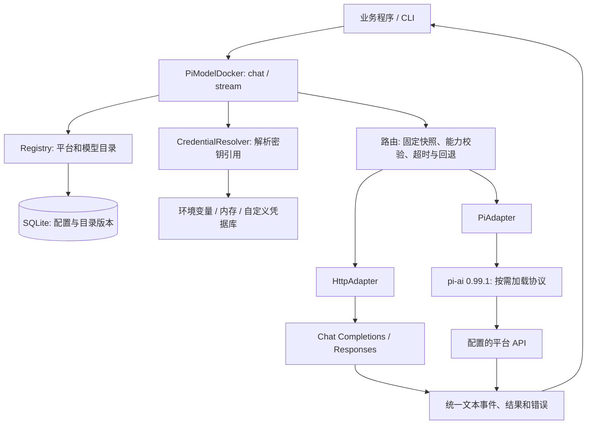
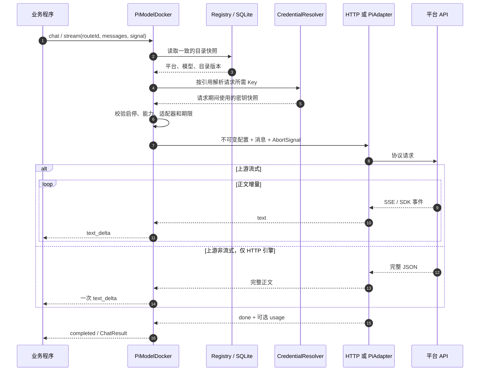
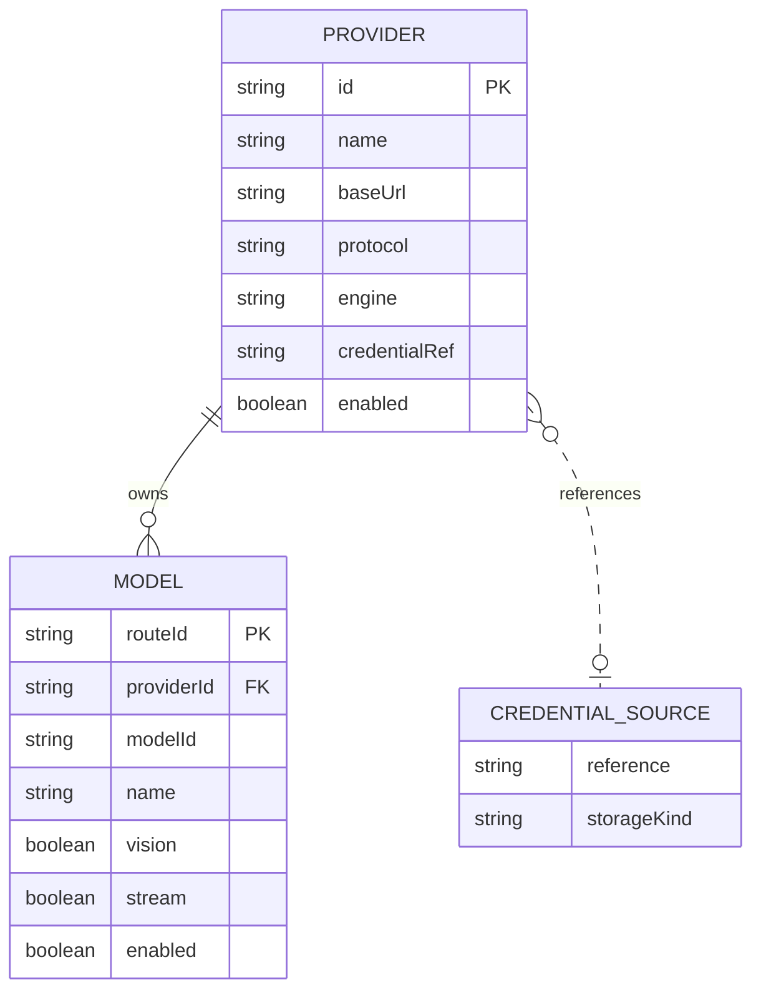

# Pi ModelDocker

Pi ModelDocker 是一个支持 pi-ai 适配的轻量级多平台模型调用框架，统一管理平台、模型与 API 密钥引用，提供文本与图片输入、流式输出和统一错误处理，让业务通过一套接口接入不同模型。

中文项目介绍与 GitHub 仓库描述见 [中文描述](docs/DESCRIPTION.zh-CN.md)。

**独立的平台配置、模型目录与统一调用库。**

给业务代码一个稳定的 `routeId`，由 PiModelDocker 查找平台、解析密钥引用、检查图片能力并调用相应协议。支持直接 HTTP，以及可选的 [pi-ai](https://github.com/earendil-works/pi/tree/main/packages/ai) 适配层。

这是一个新的 TypeScript/Node.js 项目。它没有修改或依赖 AutoAIAnswer，没有截图、手机 UI，也没有自动执行工具的 Agent 循环。你可以把这个目录单独放进 `pi-modeldocker` 仓库。


项目名称：**Pi ModelDocker** · 建议仓库名：`pi-modeldocker` · 包名：`pi-modeldocker-core` · CLI：`pi-modeldocker`。

这是围绕 pi-ai 适配能力建立的独立项目，不是 pi 官方发行版。SDK 的主类名为 `PiModelDocker`，错误类为 `PiModelDockerError`。

## 技术总览与图示

下面三张图是 Mermaid 源码，可以在支持 Mermaid 的 Markdown 阅读器中显示。详细设计见 [架构文档](docs/ARCHITECTURE.md)，字段和接口见 [配置契约](docs/CONFIGURATION.md)。

### 1. 分层架构



业务只传稳定 `routeId`、消息与可选 prompt；API 地址、Key 和协议处理都在调用层内。SQLite 不保存真实 Key。Router 是 `client.ts` 内的执行流程，不是额外后台服务。

### 2. 一次请求的处理流程



图中展示成功路径。401/429 等错误会归一化返回；只有显式配置、未输出正文时的 402 才尝试一次回退。取消或到达总截止时间时中止等待，不再返回完成结果。配置更新只影响后续请求。

### 3. 平台、模型和密钥的关系



这是逻辑关系图：一个平台拥有多个模型；平台只引用凭据来源。`CREDENTIAL_SOURCE` 不是 SQLite 表，真实 Key 来自独立 resolver。实际数据库是 `providers`、`models`、`state` 三张表，配置字段保存在经过校验的 JSON 中。

### 技术文档导航

| 文档 | 内容 |
|---|---|
| [ARCHITECTURE](docs/ARCHITECTURE.md) | 分层边界、数据流、事务、快照、取消、回退、安全与扩展点 |
| [CONFIGURATION](docs/CONFIGURATION.md) | 完整配置字段、SDK 方法、消息、返回结构、错误码 |
| [SPEC-MAPPING](docs/SPEC-MAPPING.md) | 原 spec 已实现部分，以及 UI、凭据库、旧应用迁移等未包含范围 |
| [VALIDATION](docs/VALIDATION.md) | 测试覆盖、环境、验证结论与已知限制 |

## 已实现

- 平台与模型一对多；稳定路线 ID；SQLite 持久化、完整配置原子导入与乐观版本检查。
- 平台/模型增删改、启停、选中项、面向前端的脱敏目录。
- 密钥仅通过环境变量或内存 resolver 提供，配置和 SQLite 不保存真实 Key。
- HTTP Chat Completions / Responses：文本、多图、真正的非流式请求，以及 SSE。
- pi-ai 0.99.1：自定义平台的 Chat Completions、Responses、Anthropic Messages、Google Generative AI。
- 统一 `chat()` / `stream()`，结构化结果、错误、可选 usage；不内置或替换业务 prompt。
- 能力检查、请求快照、总截止时间、取消、显式一次 402 回退。
- 命令行、离线演示、图片测试、协议与数据库测试。

## 运行要求

Node.js **22.19.0 或更高**，npm。使用 Node 内置 `node:sqlite`，某些版本会显示实验性提示；不需要另外安装 SQLite、Python 或数据库服务。

```bash
npm ci
npm run check
node examples/offline-demo.mjs
```

`npm run check` 执行 TypeScript 构建与自动测试。测试只连接本机临时模拟服务器，**不调用真实付费 API**。

## 用你自己的平台

以已验证接入格式的 AK AII GPT-5.5 为例，配置见 [examples/akaii.json](examples/akaii.json)。该文件只是地址/模型预设，不含密钥，也不承诺平台此刻的可用性。

```bash
npm run build
node dist/cli.js init examples/akaii.json
```

在当前终端设置密钥。macOS/Linux：

```bash
export AKAII_API_KEY='填入自己的密钥'
```

Windows PowerShell：

```powershell
$env:AKAII_API_KEY = '填入自己的密钥'
```

也可以复制 `.env.example` 为 `.env`，仅保存在本机，再运行 `node --env-file=.env dist/cli.js ...`。程序不会自动加载任意目录的 `.env`。

```bash
# 只检查本地配置状态，不请求供应商
node dist/cli.js catalog

# 以下命令会实际请求供应商，可能产生费用
node dist/cli.js test akaii-gpt-5.5
node dist/cli.js test akaii-gpt-5.5 --mode vision
node dist/cli.js chat akaii-gpt-5.5 "请回答图片中的题目并给出解析。" --image "/path/to/image.png"
```

`test --mode vision` 使用内置的无私人信息小图；它验证图片调用是否成功，不自动评判模型答案质量。未传 `--image` 时不会读取你的桌面或截图。

查看所有命令：

```bash
node dist/cli.js help
```

数据库默认是当前目录的 `pi-modeldocker.sqlite`，可用 `--db /path/to/config.sqlite` 指定。`init` 不覆盖非空数据库；`import` 表示完整替换配置。`export` 只导出配置与密钥引用，且不覆盖已存在的目标文件。

## 给平台添加第二个模型

平台地址与 Key 引用只写一次。在 `models` 数组里增加模型：

```json
{
  "routeId": "akaii-another-model",
  "providerId": "akaii",
  "name": "另一个模型",
  "modelId": "填写平台实际支持的模型ID",
  "capabilities": { "text": true, "vision": true },
  "stream": false
}
```

编辑完整 JSON 后执行 `node dist/cli.js import config.json`，无需修改调用代码或重编译。模型能否调用仍取决于供应商权限、余额和实际能力。

通过 SDK 可以增量编辑，而不用替换整份配置：

```typescript
registry.putProvider({
  id: 'my-provider', name: '我的平台',
  baseUrl: 'https://your-provider.example/v1',
  protocol: 'chat_completions', credentialRef: 'env:MY_PROVIDER_API_KEY',
});
registry.putModel({
  routeId: 'my-model', providerId: 'my-provider',
  name: '图片模型', modelId: '平台要求的精确ID',
  capabilities: { text: true, vision: true }, stream: false,
});
```

`putProvider` / `putModel` 是**完整记录 upsert**：修改现有记录时先读取再展开，省略字段会回到默认值，而不是保留原值。

```typescript
const model = registry.exportConfig().models.find(m => m.routeId === 'my-model')!;
registry.putModel({ ...model, enabled: false });
```

## 统一业务调用

```typescript
import { Credentials, PiModelDocker, Registry, SqliteStore } from 'pi-modeldocker-core';

const store = new SqliteStore('./pi-modeldocker.sqlite');
const registry = new Registry(store);
const ai = new PiModelDocker(registry, new Credentials());

try {
  const result = await ai.chat({
    routeId: 'akaii-gpt-5.5',
    systemPrompt: '这里传你的原始业务 prompt，库不会替换它。',
    messages: [{ role: 'user', content: [
      { type: 'text', text: '请解答这张图。' },
      { type: 'image', mimeType: 'image/png', data: imageBase64 },
    ] }],
  });
  console.log(result.text, result.routeId, result.usage);
} finally {
  store.close();
}
```

在本仓库中直接引用 `./dist/index.js`；包名导入用于安装后的项目。`data` 是纯 Base64，不带 `data:image/...;base64,` 前缀；当前支持 PNG/JPEG/WebP/GIF。库不压缩、重采样或上传图片到第三方存储。

### 流式与取消

```typescript
const controller = new AbortController();
for await (const event of ai.stream({ ...input, signal: controller.signal })) {
  if (event.type === 'text_delta') process.stdout.write(event.delta);
  if (event.type === 'completed') console.log(event.result);
  if (event.type === 'failed') console.error(event.code, event.message);
  if (event.type === 'cancelled') console.log('已取消');
}
// 在另一个 UI 操作中 controller.abort()；或提前 break，库也会终止传输。
```

`chat()` 在失败时抛出 `PiModelDockerError`；`stream()` 返回一次终止事件，不要求调用者解析各平台的错误体。

**调用形式与上游传输分开：** `ai.chat()` 表示等完整结果，`ai.stream()` 表示消费统一事件；实际 API 中的 `stream` 取决于模型配置。对于 `stream:false` 的模型，事件接口会一次发出全部正文。

## 接入 pi-ai

pi-ai 是可选 peer dependency，开发环境已固定安装 0.99.1 来验证适配。部署端如需 pi 功能，应安装该版本：

```bash
npm install @earendil-works/pi-ai@0.99.1
```

```typescript
import { PiAdapter } from 'pi-modeldocker-core/pi';
const ai = new PiModelDocker(registry, credentials, { 'pi-ai': new PiAdapter() });
```

使用 [examples/pi-custom.json](examples/pi-custom.json)，替换平台地址、精确模型 ID 与真实能力。配置 `engine: "pi-ai"`，并选择相应 protocol：

| protocol | pi-ai 底层接口 | baseUrl 形式 |
|---|---|---|
| `chat_completions` | `openai-completions` | 平台 API 基础路径，通常含 `/v1` |
| `responses` | `openai-responses` | 平台 API 基础路径，通常含 `/v1` |
| `anthropic_messages` | `anthropic-messages` | SDK 的 baseURL，例如厂商服务根地址 |
| `google_generative_ai` | `google-generative-ai` | 包含版本路径的基础地址，例如厂商 `/v1beta` |

pi 配置必须显式提供 `credentialRef`、`contextWindow`、`maxOutputTokens`；填写你平台的实际值，示例里的上下文大小不是自动发现结果。

重要边界：

- pi-ai 的完成结果接口仍基于上游流式传输。因此本库要求 pi 路线 `stream:true`；需要真正 `stream:false` 的中转平台，选择 `engine:http`。
- 不加载 pi 的全部内置模型目录；从本库 Registry 创建当前请求对应的 Provider 和 Model，避免模型白名单限制自定义模型。
- 当前桥接的是文本/图片调用，不实现工具执行、Agent 循环、OAuth 登录、思考内容展示或图片生成。
- 固定版本的 Google 适配器不支持注入自定义 fetch；使用其 SDK 原生传输与取消信号。它不能提供与其它路线完全相同的底层 HTTP 状态捕获及重定向控制；无法获取状态的失败归一为 `invalid_response`，不猜测状态码或据此跨平台回退。
- pi SDK 的价格元数据在内部设为零以满足接口，但本库**不对外报告这些值为真实费用**。缺失 usage 不估算。

## 回退、快照与超时

新模型默认没有跨平台回退。确有需要时，在主模型上配置一个 `fallbackRouteIds`：

```json
{ "fallbackRouteIds": ["another-existing-route"] }
```

只有明确的 HTTP 402 且尚未输出正文时才尝试一次；目标必须存在、启用、有凭据并支持输入。不会因未知模型、401、429 或任意网络错误自动换平台。已输出一部分正文后不会拼接另一个模型的答案。

每次请求开始时读取独立配置和凭据快照；配置更新、删模型、换 Key 只影响之后的请求。`timeoutMs` 是**整次逻辑调用的总截止时间**（含凭据解析、SDK 加载和一次回退），以初始路线为准，回退不会重置计时。自定义适配器必须尊重收到的 signal。

## 密钥与配置

SQLite 与 JSON 只保存诸如 `env:AKAII_API_KEY`、`memory:demo` 的引用。

```typescript
const credentials = new Credentials();
credentials.set('memory:demo', userEnteredKey); // 只保存在当前进程内存
```

实现 `CredentialResolver.resolve(reference)` 可接系统凭据库。本版本**未实现 Windows Credential Manager 或 AutoAIAnswer 旧设置迁移**；这是独立跨平台库，详见 [spec 对应关系](docs/SPEC-MAPPING.md)。

配置对未知字段严格报错，避免误把 `apiKey` 写入持久化记录。不要把原始配置管理接口直接暴露给不可信客户端；`registry.catalog(credentials)` 才是可发送给 UI 的脱敏视图。`available` 只是本地配置满足前提，不代表已经网络测试成功。

## 目录

```text
src/
  contracts.ts       # 类型、严格 schema、统一事件和错误
  config.ts          # URL、引用和适配器约束
  store.ts           # SQLite 原子提交、版本冲突
  registry.ts        # 平台/模型 CRUD、选择、脱敏目录
  credentials.ts     # 环境变量/内存，独立凭据接口
  client.ts          # 请求快照、能力校验、截止时间、回退
  adapters/http.ts   # Chat Completions / Responses
  adapters/sse.ts    # 增量 UTF-8 SSE 解码
  adapters/pi.ts     # 可选 pi-ai 桥接
  cli.ts             # 命令行
examples/            # 配置、SDK 示例、无费用离线演示
tests/               # 本地协议与集成测试
docs/                # 架构、配置、测试与原 spec 对照
```

## 放到独立仓库

直接把本项目目录作为新仓库内容即可；没有设置远程地址，也没有推送。`.gitignore` 已排除 node_modules、dist、密钥文件和本地数据库。`package-lock.json` 应提交，以保持可重复安装。

建议仓库名 **`pi-modeldocker`**。当前 package 标记 `private:true`，避免误发 npm；这个标记不影响把源码上传到你自己的 GitHub 仓库，也不影响 `npm pack` 本地打包。正式对外发布包前可另行确定包名和许可证；本次未代你选择授权条款。

已有数据库可通过 `--db /path/to/existing.sqlite` 显式指定。默认文件名为 `pi-modeldocker.sqlite`，也可设置 `PI_MODELDOCKER_DB`；不会自动迁移或删除已有数据库。

更多说明：[架构](docs/ARCHITECTURE.md) · [配置字段](docs/CONFIGURATION.md) · [与原 spec 的关系](docs/SPEC-MAPPING.md) · [验证报告](docs/VALIDATION.md)
