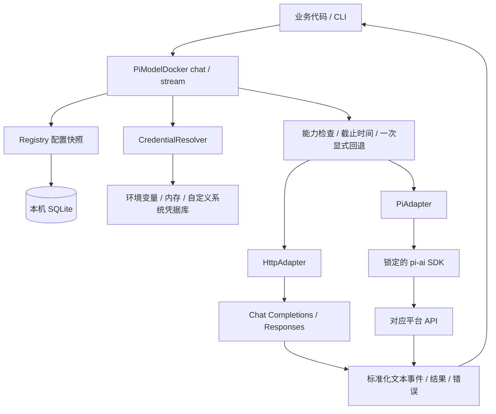

# Pi ModelDocker 架构

状态：独立 SDK v0.1.2；不含 AutoAIAnswer 集成。

## 数据流

Router 当前是 `client.ts` 内部的请求执行流程，尚不单独导出一个 Router 类；它与 Registry、Adapter 的边界已经分离。

## 模块边界

| 层 | 负责 | 不负责 |
|---|---|---|
| Registry / Store | 配置校验、CRUD、事务、稳定 ID、目录版本 | 网络调用、保存 Key 明文 |
| CredentialResolver | 根据引用取得当前密钥 | 模型列表、业务 prompt |
| PiModelDocker | 固定快照、能力验证、选适配器、期限、回退、统一事件 | 供应商 JSON 格式、UI、工具执行 |
| HttpAdapter | 两类协议、鉴权、JSON/SSE 处理 | 修改目录、选择其它平台 |
| PiAdapter | 组装 pi Provider/Model/Context、规范化 pi 事件 | pi agent 的工具循环、内置模型全部加载 |
| 业务层 | prompt、历史、图片来源、展示、是否调用 | 平台请求细节 |

## 为什么同时有 HTTP 与 pi-ai

直接 HTTP 能严格表达 `stream:false`，适合本次已测试过的中转图片请求。pi-ai 屏蔽更多厂商协议，但其完成接口基于上游流式调用，因此不能把 `models.complete()` 直接解释为“非流式 HTTP”。两种引擎共用 Registry、凭据和结果格式，业务无需改变输入。

核心入口不导入 pi-ai。只在注册并运行 PiAdapter 时导入锁定 SDK 和选中的协议模块。SDK 版本升级需跑桥接测试，不能跟随 latest 自动改变运行行为。

## 配置一致性

Store schema v1 使用 providers、models、state 三张表。完整提交在 `BEGIN IMMEDIATE` 事务中校验 expectedRevision 并更新，失败回滚。Registry 的增量编辑基于读到的版本提交。另一进程已保存时返回 conflict，不自动覆盖。

每次 `snapshot()` 在读取事务中取得一致的目录和 revision。请求收到后会复制并校验 messages、读取整个目录、读取候选路线对应的凭据，再开始调用。后续修改不影响在途请求。调用是惰性的：SDK 的 async generator 开始迭代时才建立快照；仅构造 generator 不代表请求已经开始。

凭据解析不是数据库事务的一部分。内置环境/内存 resolver 在调用时读取值；自定义异步 vault 应保证单次 resolve 返回稳定值。PiModelDocker 不承诺多个独立外部 vault 的跨系统原子快照。

## 状态与事件

常见成功序列：`started → text_delta* → completed`。

错误可能发生在 started 之前（例如未知路线或读取密钥超时）。有且只有一个终止事件：completed / failed / cancelled。`chat()` 消费事件并返回结果或抛出安全错误；`stream()` 的使用方消费事件。

显式回退：`started(primary) → fallback(primary, backup) → text_delta(backup)* → completed(backup)`。结果同时记录 requestedRouteId 与实际 routeId。第二个模型不会再次回退；主模型产生任何非空文本后也不再回退。

应用可以将这些事件映射到自己的 WebSocket 协议；本 SDK 不创建监听端口或后台服务，也不在回调中自动推送目录。

## 取消与资源

初始路线 timeoutMs 是整次逻辑请求的截止时间，覆盖凭据解析、pi 模块加载、正文接收和一次回退。计时器在结束后清理；消费者提前结束迭代时，finally 会触发 AbortSignal。即使外部 Adapter 不合作，面向调用方的等待仍被 deadline race 截断；不合作的外部 I/O 自身是否释放，仍依赖 Adapter 正确使用 signal。

消费者长时间停在 yield 上也计入总截止时间。若业务要慢速展示，应尽快读取事件再自行排队展示。

## 能力和费用

capabilities 是配置声明；catalog.available 只检查启停与 Key 是否可解析，不等于平台已验证可用。真实 test 调用不自动改 capabilities，也不保存“永久可用”的状态。

输出 usage 仅在提供方/SDK给出值时暴露，不做费用估算。pi 要求的内部 cost 元数据不对外作为真实计费数据。当前不接收工具消息，不执行模型产生的命令。

## 安全边界

- 配置由可信本机操作者提供；不存在公共 HTTP 管理 API。
- JSON/SQLite 保存 credentialRef；真实 Key 只进入当前请求。
- 核心无自动日志；标准错误不包含上游 body、请求 header 或 cause。
- HTTP 和支持 fetch 注入的 pi 路线禁止重定向；Google 路线使用 SDK 原生传输，其限制单独记录。
- HTTPS 校验不关闭；HTTP 必须显式 allowHttp。该项供受信任的本地服务/测试使用。
- 消息文本和配置名称若交给网页渲染，应用应使用文本节点；SDK 不负责模板渲染。

## 后续扩展点

1. 操作系统凭据：实现 CredentialResolver；如果需要管理写入，还需设计独立 CredentialWriter 和配置提交补偿。
2. 新协议：实现 Adapter，通过构造参数注册对应 engine，并扩展严格 schema。
3. UI：从 catalog() 获取脱敏目录，通过主机可信管理层调用 Registry CRUD。
4. HTTP 网关：另设经过鉴权的 transport，不直接把完整 Registry 接口暴露给局域网/互联网。
5. 旧应用迁移：单独做旧配置导入器；核心库不读取特定产品的 QSettings。
